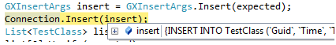

# Gurux ORM

**Gurux ORM** is an open-source object-relational mapper for C#, distributed as the `Gurux.Service` NuGet package. It maps C# models to database tables and uses lambda expressions to build queries across multiple database engines.

Part of the [Gurux Device Framework](https://www.gurux.org/).

---

## ✨ Features

- Unified ORM interface for multiple databases  
- Automatic table creation and relation traversal  
- See generated SQL in debug mode (hover on the argument)  
- Lambda-expression query support  
- Attribute-driven schema mapping  
- Supports `1:1`, `1:N`, and `N:N` relationships
- [Cached schema status](docs/schema-status.md) through `GXSchemaManager`, with concurrent scan coalescing and DDL invalidation

---

## 🗃️ Supported Databases

- [MySQL](http://www.mysql.com/)
- [MariaDB](http://www.mariadb.com/)
- [Microsoft SQL Server](http://www.microsoft.com/)
- [Oracle](http://www.oracle.com/)
- [SQLite](http://www.sqlite.com/)
- [PostgreSql](https://www.postgresql.org/)
- [SAP Hana](https://help.sap.com/docs/HANA_CLOUD)
- [DB2](https://www.ibm.com/products/db2)

---

## Installation

Install the ORM and an ADO.NET provider for your database. For the SQLite example below:

```shell
dotnet add package Gurux.Service
dotnet add package System.Data.SQLite.Core
```

The current source project targets .NET 9 and .NET 10. Building all targets requires the corresponding SDKs or targeting packs.

Use these namespaces for the model and query examples:

```csharp
using Gurux.Service.Orm;
using Gurux.Service.Orm.Common;
using Gurux.Service.Orm.Common.Enums;
using System.Collections.Generic;
using System.ComponentModel.DataAnnotations;
using System.Runtime.Serialization;
```

## ⚙️ Key Attributes

| Attribute | Description |
| --- | --- |
| `DataMember` | Marks a field to be stored in the database. |
| `AutoIncrement` | Increases on insert; value is written back to the object. |
| `ForeignKey` | Defines a foreign key relation. |
| `Relation` | Declares a relation between tables. |
| `Alias` | SQL alias for fields/tables. |
| `StringLength(int max)` | Specifies the maximum string length in the schema. |
| `IsRequired` | Field must have a value (NOT NULL). |

---

## 🔗 Relations

Gurux ORM supports:

- **1:1** — One-to-One  
- **1:N** — One-to-Many  
- **N:N** — Many-to-Many

---

## 🏗️ Defining C# Classes

Implement `IUnique<T>` on entities that expose an `Id` property, as shown below. Use `DataContract` and `DataMember` to declare the mapped model and its columns.

`UseEnumStringValue` and `UseEpochTimeFormat` are database settings, rather than model attributes.

---

## Models

### Country ↔ Company (1:N)

`GXCountry` maintains a list of its companies and cascades deletes.

```csharp
[DataContract]
class GXCountry : IUnique<int>
{
    [DataMember(Name = "ID"), AutoIncrement]
    public int Id { get; set; }

    [DataMember(Name = "CountryName"), IsRequired, StringLength(100)]
    public string Name { get; set; }

    [DataMember]
    [ForeignKey(OnDelete = ForeignKeyDelete.Cascade)]
    public List<GXCompany> Companies { get; set; }
}

[DataContract]
class GXCompany : IUnique<long>
{
    [AutoIncrement, DataMember]
    public long Id { get; set; }

    [DataMember, IsRequired, StringLength(150)]
    public string Name { get; set; }

    // Navigation to Country; FK column is auto-managed (e.g., CountryID)
    [DataMember(Name = "CountryID"), ForeignKey]
    public GXCountry Country { get; set; }
}
```

**Usage Example:**

```csharp
GXCountry finland = new GXCountry { Name = "Finland" };
GXCompany gurux = new GXCompany { Name = "Gurux Ltd", Country = finland };
GXCompany sample = new GXCompany { Name = "Sample Co", Country = finland };
finland.Companies = new List<GXCompany> { gurux, sample };

// Create Country and all related tables in one go (including Company)
Connection.CreateTable<GXCountry>(true, false);

Connection.Insert(GXInsertArgs.Insert(finland));
```

---

### Company ↔ Users (1:N)

To extend the country/company model, add this property to `GXCompany`. The `GXUser` model in the next section holds the corresponding company reference.

```csharp
[DataMember, ForeignKey(OnDelete = ForeignKeyDelete.Cascade)]
public GXUser[] Users { get; set; }
```

The following sections extend the same model. Combine the properties in one declaration per class.

---

### Users ↔ UserGroups (N:N)

```csharp
[DataContract]
class GXUser : IUnique<int>
{
    [AutoIncrement, DataMember]
    public int Id { get; set; }

    [DataMember, IsRequired, StringLength(120)]
    public string Name { get; set; }

    [DataMember, ForeignKey(typeof(GXUserGroup), typeof(GXUserToUserGroup))]
    public GXUserGroup[] Groups { get; set; }

    [DataMember, ForeignKey(OnDelete = ForeignKeyDelete.Cascade)]
    public GXCompany Company { get; set; }
}

[DataContract]
class GXUserGroup : IUnique<int>
{
    [AutoIncrement, DataMember]
    public int Id { get; set; }

    [DataMember, IsRequired, StringLength(120)]
    public string Name { get; set; }

    [DataMember, ForeignKey(typeof(GXUser), typeof(GXUserToUserGroup))]
    public GXUser[] Users { get; set; }
}

[DataContract]
class GXUserToUserGroup
{
    [DataMember, ForeignKey(typeof(GXUser), OnDelete = ForeignKeyDelete.Cascade)]
    public int UserId { get; set; }

    [DataMember, ForeignKey(typeof(GXUserGroup), OnDelete = ForeignKeyDelete.Cascade)]
    public int GroupId { get; set; }
}
```

**Usage Example:**

```csharp
GXUserGroup adminGroup = new GXUserGroup { Name = "Admin" };
GXUserGroup devGroup = new GXUserGroup { Name = "Developers" };

GXCompany gurux = new GXCompany { Name = "Gurux Ltd" };
GXUser user = new GXUser
{
    Name = "Charlie",
    Company = gurux,
    Groups = new[] { adminGroup, devGroup }
};

// Create UserGroup and all related tables (bridge + users + company) in one go
Connection.CreateTable<GXUserGroup>(true, false);

Connection.Insert(GXInsertArgs.Insert(user));
```

---

## ⚡ Quick Start

The following example is self-contained. It uses an in-memory SQLite database and a simple model to demonstrate create, read, update, and delete operations.

```csharp
using Gurux.Service.Orm;
using Gurux.Service.Orm.Common;
using System.ComponentModel.DataAnnotations;
using System.Data.SQLite;
using System.Runtime.Serialization;

class Program
{
    static void Main()
    {
        using var sqlite = new SQLiteConnection("Data Source=:memory:");
        // GXDbConnection opens the underlying connection if necessary.
        var connection = new GXDbConnection(sqlite);
        connection.CreateTable<Person>(true, false);

        var person = new Person { Name = "Alice" };
        connection.Insert(GXInsertArgs.Insert(person));
        // The generated ID is written back to person.Id.

        var query = GXSelectArgs.Select<Person>(p => "*", p => p.Id == person.Id);
        var people = connection.Select<Person>(query);

        person.Name = "Alice Updated";
        connection.Update(GXUpdateArgs.Update(person, p => p.Name));
        connection.Delete(GXDeleteArgs.Delete(person));
    }
}

[DataContract]
public class Person : IUnique<int>
{
    [DataMember, AutoIncrement]
    public int Id { get; set; }

    [DataMember, IsRequired, StringLength(120)]
    public string Name { get; set; } = string.Empty;
}
```

The remaining examples use the related `GXCountry`, `GXCompany`, `GXUser`, and `GXUserGroup` models above. `Connection` denotes an initialized `GXDbConnection`.

---

## 🔍 Query Examples

### N:N Join (Users ↔ Groups)

```csharp
GXSelectArgs arg = GXSelectArgs.Select<GXUser>(s => "*");
arg.Columns.Add<GXUserGroup>();
arg.Joins.AddInnerJoin<GXUser, GXUserToUserGroup>(j => j.Id, j => j.UserId);
arg.Joins.AddInnerJoin<GXUserToUserGroup, GXUserGroup>(j => j.GroupId, j => j.Id);

var list = Connection.Select<GXUser>(arg);
```

#### Filtering & sorting for N:N

Only users in the "Developers" group, ascending by user name:

```csharp
GXSelectArgs arg = GXSelectArgs.Select<GXUser>(s => "*");
arg.Columns.Add<GXUserGroup>();
arg.Joins.AddInnerJoin<GXUser, GXUserToUserGroup>(j => j.Id, j => j.UserId);
arg.Joins.AddInnerJoin<GXUserToUserGroup, GXUserGroup>(j => j.GroupId, j => j.Id);

// Filter: group name equals "Developers"
arg.Where.And<GXUserGroup>(g => g.Name == "Developers");

// Sort: users by Name (ascending)
arg.OrderBy.Add<GXUser>(u => u.Name);

var developers = Connection.Select<GXUser>(arg);
```

**Alternative (portable) approach using a subquery:**

```csharp
// Subquery: find group IDs with name 'Developers'
var groupsSub = GXSelectArgs.Select<GXUserGroup>(g => g.Id, g => g.Name == "Developers");

// Users whose Groups contain one of the subquery results
var usersInDevs = GXSelectArgs.Select<GXUser>(
    s => "*",
    u => GXSql.In(u.Groups, groupsSub)
);

// Optional sort
usersInDevs.OrderBy.Add<GXUser>(u => u.Name);

var developers2 = Connection.Select<GXUser>(usersInDevs);
```

---

### Separate blocks for filtering and sorting

#### Filtering only

```csharp
GXSelectArgs arg = GXSelectArgs.Select<GXUser>(s => "*");
arg.Where.And<GXUser>(c => c.Name.StartsWith("Cha"));

var filtered = Connection.Select<GXUser>(arg);
```

#### Sorting only

```csharp
GXSelectArgs arg = GXSelectArgs.Select<GXUser>(s => "*");
arg.OrderBy.Add<GXUser>(c => c.Name);

var sorted = Connection.Select<GXUser>(arg);
```

> You can also combine:
> 
> ```csharp
> GXSelectArgs arg = GXSelectArgs.Select<GXUser>(s => "*");
> arg.Where.And<GXUser>(c => c.Name.StartsWith("Cha"));
> arg.OrderBy.Add<GXUser>(c => c.Name);
> var result = Connection.Select<GXUser>(arg);
> ```

---

### Selecting Related Data (1:N Join Example)

```csharp
GXSelectArgs arg = GXSelectArgs.SelectAll<GXCountry>();
arg.Columns.Add<GXCompany>();
arg.Joins.AddInnerJoin<GXCountry, GXCompany>(c => c.Id, c => c.Country);
List<GXCountry> countries = Connection.Select<GXCountry>(arg);
```

---

## 🚫 `Exclude<T>()` (Select & Update)

Use `Exclude<T>()` to omit specific fields from **queries** and **updates**. Great for skipping heavy columns on read and avoiding server-managed columns on update.

**Exclude in Select**

```csharp
GXSelectArgs args = GXSelectArgs.SelectAll<GXUser>();
args.Exclude<GXUser>(q => q.Company);
var users = Connection.Select<GXUser>(args);
```

**Exclude in Update**

```csharp
// user is an existing GXUser instance.
GXUpdateArgs args = GXUpdateArgs.Update(user);
args.Exclude<GXUser>(q => new { q.Id, q.Company });
Connection.Update(args);
```

For a targeted update, explicitly select the properties to change, as shown below.

---

## 🔁 Update

```csharp
user.Name = "UpdatedName";
Connection.Update(GXUpdateArgs.Update(user, q => q.Name));
```

---

## 🛠️ Schema Management

`GXSchemaManager` is used when you need to create, inspect, update, rename, or drop database schema objects directly from ORM model classes.

```csharp
using Gurux.Service.Orm;
using Gurux.Service.Orm.Model;

GXDbConnection Connection = new GXDbConnection(dbConnection, null);
GXSchemaManager manager = new GXSchemaManager(Connection);

// Create the table from the current model.
manager.CreateTable<GXUser>(createRelations: true, ignoreErrors: false);

// Update an existing table to match the current model.
manager.UpdateTable<GXUser>();

// Inspect the current database schema.
GXTableSchema schema = manager.Describe<GXUser>();

// Rename a table or column when needed.
manager.RenameTable<GXUser>("Users");
manager.RenameTableColumn<GXUser>(q => q.Name, "UserName");
```

### Changing a Column Data Type

To change a column from one data type to another, update the C# model property type and call `UpdateTable<T>()`. `GXSchemaManager` compares the existing database table with the current model, creates a temporary converted column, copies converted values into it, drops the old column, and renames the converted column back to the original name.

For example, if `GXDevice.SerialNumber` was previously stored as `string` and you want to store it as `int`, change the model:

```csharp
[DataContract]
class GXDevice : IUnique<int>
{
    [DataMember, AutoIncrement]
    public int Id { get; set; }

    [DataMember]
    public int SerialNumber { get; set; }
}
```

Then update the table:

```csharp
GXSchemaManager manager = new GXSchemaManager(Connection);
manager.UpdateTable<GXDevice>();
```

The default conversion uses the database settings' normal type conversion. This is enough for simple conversions such as numeric text to numeric values when all existing values are valid.

### Custom Value Conversion

Use `ColumnValueConverting` when existing values need special handling during a column type change. The event is raised for each distinct non-null value before it is written into the converted column.

Set `e.Value` to the converted value and `e.IsConverted` to `true` when your handler has completed the conversion. If `IsConverted` is left as `false`, Gurux ORM uses the default conversion.

```csharp
EventHandler<GXColumnValueConvertingEventArgs> converter = (sender, e) =>
{
    if (e.TableName == "GXDevice" &&
        e.ColumnName == "SerialNumber" &&
        e.OldType == typeof(string) &&
        e.NewType == typeof(int))
    {
        string value = (string)e.Value;

        // Example: convert values like "SN-12345" to 12345.
        e.Value = int.Parse(value.Replace("SN-", ""));
        e.IsConverted = true;
    }
};

try
{
    manager.ColumnValueConverting += converter;
    manager.UpdateTable<GXDevice>();
}
finally
{
    manager.ColumnValueConverting -= converter;
}
```

`GXColumnValueConvertingEventArgs` contains:

| Property | Description |
| --- | --- |
| `TableName` | Name of the table being updated. |
| `ColumnName` | Name of the column being converted. |
| `OldType` | Previous C# type mapped from the existing database column. |
| `NewType` | New C# type from the current model. |
| `Value` | Current value. Set this to the converted value. |
| `IsConverted` | Set to `true` when the handler has converted `Value`. |

---

## ❌ Delete

```csharp
// Preferred when you have the instance:
Connection.Delete(GXDeleteArgs.Delete(user));

// If only the ID is known:
Connection.Delete(GXDeleteArgs.DeleteById<GXUser>(5));
```

---

## 🧠 Subqueries

```csharp
GXSelectArgs sub = GXSelectArgs.Select<GXUser>(q => q.Id, q => q.Id > 100);
GXSelectArgs arg = GXSelectArgs.Select<GXUserGroup>(null, q => GXSql.In(q.Users, sub));
```

---

## Checking Whether a Table Is Empty

```csharp
GXSelectArgs arg = GXSelectArgs.IsEmpty<GXUser>();
if (Connection.SingleOrDefault<bool>(arg))
{
    // Table is empty
}
else
{
    // Table has at least 1 record
}
```

---

## 📚 Further Resources

For additional examples and database-specific tests, see [Gurux.Service_Simple_UnitTests](Gurux.Service_Simple_UnitTests/).

To build from the repository root:

```shell
dotnet build Development/Gurux.Service.sln
```

The project is licensed under GPL-2.0-only. See [LICENSE](LICENSE).

Need help?  
Ask your questions on the [Gurux Forum](https://www.gurux.fi/forum/gurux.service).

---


